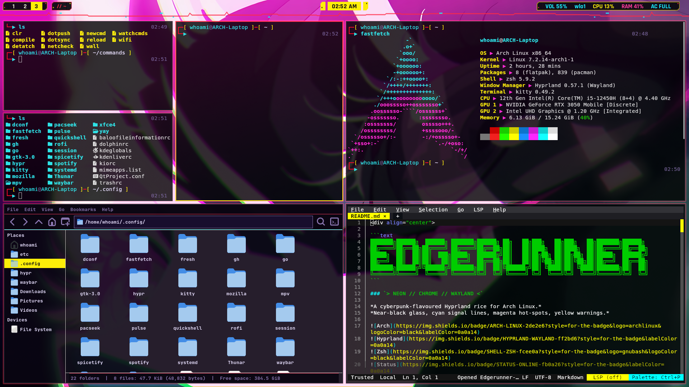
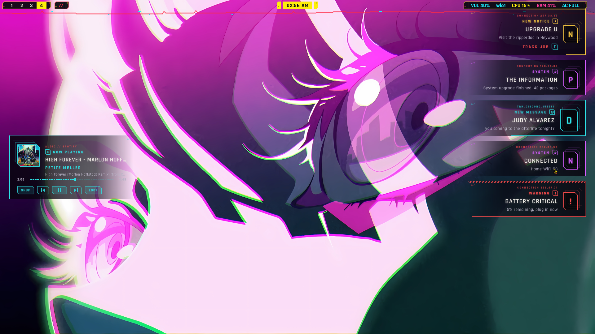
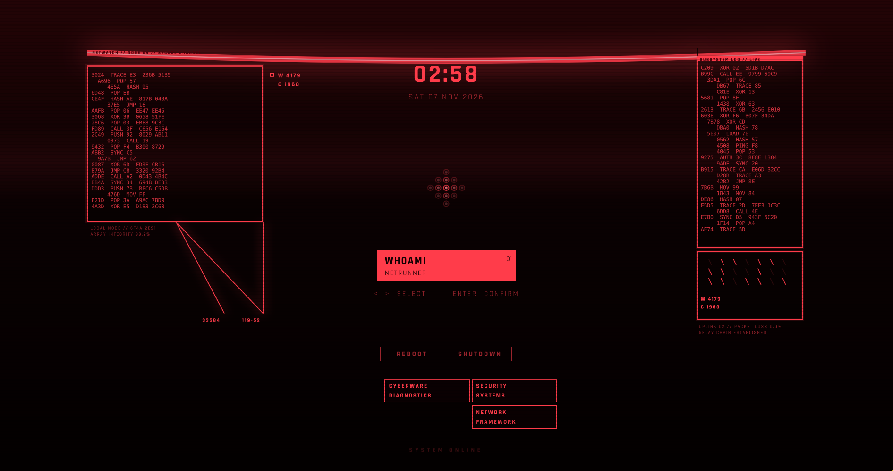

<div align="center">

```text
███████╗██████╗  ██████╗ ███████╗██████╗ ██╗   ██╗███╗   ██╗███╗   ██╗███████╗██████╗ 
██╔════╝██╔══██╗██╔════╝ ██╔════╝██╔══██╗██║   ██║████╗  ██║████╗  ██║██╔════╝██╔══██╗
█████╗  ██║  ██║██║  ███╗█████╗  ██████╔╝██║   ██║██╔██╗ ██║██╔██╗ ██║█████╗  ██████╔╝
██╔══╝  ██║  ██║██║   ██║██╔══╝  ██╔══██╗██║   ██║██║╚██╗██║██║╚██╗██║██╔══╝  ██╔══██╗
███████╗██████╔╝╚██████╔╝███████╗██║  ██║╚██████╔╝██║ ╚████║██║ ╚████║███████╗██║  ██║
╚══════╝╚═════╝  ╚═════╝ ╚══════╝╚═╝  ╚═╝ ╚═════╝ ╚═╝  ╚═══╝╚═╝  ╚═══╝╚══════╝╚═╝  ╚═╝
```

### `> NEON // CHROME // WAYLAND <`

*A cyberpunk-flavoured Hyprland rice for Arch Linux.*
*Near-black glass, cyan signal lines, magenta hot-spots, yellow warnings.*


</div>

---

## `// 00` SYSTEM OVERVIEW

This repo is the full configuration for my daily-driver desktop, codename **edgerunners**. It covers everything from the login screen to the prompt in my terminal: the compositor, the bar, the launcher, the shell, the theming, and a small collection of custom commands that glue it all together.

The design goal is simple: **one consistent look, minimal clutter, everything reproducible.** If my machine died tonight, I should be able to clone this repo on a fresh Arch install, run one script, and be back in the grid within minutes.

The visual identity is built on a single palette (see [`// 02`](#-02-palette)) that is reused everywhere: the shell prompt, `ls` colors, `fzf`, syntax highlighting, and the GUI configs. That's what makes it feel like one system instead of a pile of dotfiles.

> **Heads up:** these are *my* configs. They are meant to be read, borrowed from, and adapted, not blindly applied over a setup you care about. The install script backs up what it replaces, but read the [warnings](#-04-install) first.

---

## `// 01` INSTALL

```bash
git clone <repo-url> Edgerunner-dotfiles
cd Edgerunner-dotfiles
./install.sh
```

Run it as your normal user. It uses `sudo` only for system files like `/etc/greetd`. You get a menu with Install, Update, Uninstall, Pull, Status and Quit. You can also call the commands directly:

| Command | What it does |
|---|---|
| `./install.sh install` | Backs up your current setup, then installs the dotfiles |
| `./install.sh update` | Pulls the latest version from git and applies only what changed |
| `./install.sh uninstall` | Removes the dotfiles and restores your old setup |
| `./install.sh status` | Shows what's installed and where the backup is |

Add `-y` to skip prompts and `--fast` to skip the animations.

## How the backup works

Nothing is overwritten until your current setup is saved to `~/.dotfiles-backup/<date-time>/`:

- **Archives of your files:** one tarball of your user configs (`~/.config`, shell rc files, themes, fonts, icons, `~/commands`) and one of the system files the installer can touch (`/etc/greetd`, systemd units, and similar).
- **System state:** your package lists, enabled services, dconf/GTK settings and your Hyprland version.
- **Originals:** the exact files the installer replaces are copied, so uninstall can put them back.

Your `~/.bashrc` is never replaced. The installer appends a marked block, and uninstall removes that block cleanly.

`uninstall` deletes the installed files and restores your originals from the backup. The backup folder is kept afterwards, so delete it yourself once you're happy.

`update` saves anything it overwrites to `<backup>/updates/<date-time>/` first, and it never touches your original backup.

## After installing

Run `hyprctl reload`. Log out and back in if the greetd or shell files changed.

Packages from `packages.txt` are only installed if you say yes, and uninstall leaves them installed.


---

## `// 02` THE STACK

| Layer | Component | Role |
|:--|:--|:--|
| **Login** | `greetd` | Minimal login manager, configured in `/etc/greetd` |
| **Compositor** | `Hyprland` | Wayland tiling compositor, config in `~/.config/hypr` |
| **Bar** | `waybar` | Status bar: workspaces, clock, system info |
| **Shell widgets** | `quickshell` | QML-based custom shell components |
| **Launcher** | `rofi` | App launcher and menus |
| **Terminal** | `kitty` | GPU-accelerated terminal emulator |
| **Shell** | `zsh` | Custom two-line prompt, command timer, git status, fzf |
| **Editor** | `fresh` | Terminal text editor, also used by the `newcmd` helper |
| **Wallpaper** | `swaybg` | Driven by my `wall` command |
| **Files** | `Thunar` (+ `xfce4` settings) | Graphical file manager |
| **Media** | `mpv`, `spotify` + `spicetify` | Video player; Spotify with a custom theme |
| **Sysinfo** | `fastfetch` | The obligatory neofetch flex |
| **Packages** | `yay`, `pacseek` | AUR helper and a TUI for browsing packages |
| **Theming** | `gtk-3.0`, `dconf` | GTK appearance and desktop settings |
| **Background services** | `systemd` (user units) | Autostart services and helpers |

---

## `// 03` PALETTE

One palette, used everywhere. Neon on near-black.

| | Name | Hex | Used for |
|:-:|:--|:--|:--|
|  | **Cyan** | `#2de2e6` | Commands, directories, prompt arrow, primary accent |
|  | **Bloodred** | `#FB0A26` | Symlinks, fzf highlights and borders |
|  | **Yellow** | `#fcee0a` | Brackets, strings, executables, warnings |
|  | **Red** | `#fb0a26` | Prompt frame, git branch, separators |
|  | **Alert red** | `#ff3b5c` | Errors, failed-command arrow, unknown tokens |
|  | **Dim violet** | `#6b5a8a` | Comments, suggestions, secondary text |
|  | **Ink** | `#e8e0ff` | Main foreground text |
|  | **Deep purple** | `#1a1030` | Selection backgrounds |

---

## `// 04` REPO LAYOUT

```text
Edgerunner-dotfiles/
├── README.md          ← you are here
├── install.sh         ← deploys everything
├── packages.txt       ← explicitly installed packages
├── .gitignore
│
├── home/              ← mirrors $HOME
│   ├── .zshrc
│   ├── .config/       ← hypr, waybar, kitty, rofi, quickshell, ...
│   ├── commands/      ← custom scripts (added to PATH)
│   └── Pictures/
│       └── wallpapers/
│
├── etc/               ← mirrors /etc (needs root)
│   ├── zsh/
│   ├── gtk-3.0/
│   ├── greetd/
│   └── fonts/
│
└── extras/
    └── dconf.ini      ← exported desktop settings
```

The `home/` folder mirrors your home directory exactly, so `home/.config/hypr` belongs at `~/.config/hypr`. The `etc/` folder does the same for `/etc`, but those files are **copied**, not symlinked, because a broken symlink in a system folder like `/etc/greetd` could stop you from logging in.

---

## `// 05` INSTALL

> ⚠️ **Read before you run.** The install script touches your home directory and, with `sudo`, parts of `/etc` including the **login manager config**. Existing files are moved to `~/.dotfiles_backup/<timestamp>/` first, but if you only want some of this, copy the pieces by hand instead.

**1. Get an AUR helper** (needed for some packages):

```bash
sudo pacman -S --needed git base-devel
git clone https://aur.archlinux.org/yay.git /tmp/yay
cd /tmp/yay && makepkg -si
```

**2. Clone the repo:**

```bash
git clone https://github.com/PYX-IMPACT/Edgerunner-dotfiles ~/Edgerunner-dotfiles
cd ~/Edgerunner-dotfiles
```

**3. Install the packages** (review `packages.txt` first, it's a superset of what you strictly need):

```bash
yay -S --needed $(cat packages.txt)
```

**4. Deploy:**

```bash
chmod +x install.sh
./install.sh
```

**5. Log out and back in** (or reboot, if you replaced the greetd config).

---

## `// 06` CUSTOM COMMANDS

Everything in `~/commands` is on `$PATH` (set in `.zshrc`), so these work from anywhere.

| Command | What it does |
|:--|:--|
| **`wall [image]`** | Sets the wallpaper. With an image argument, copies it to `~/Pictures/Current.jpg` and applies it. With no argument, just reloads the current one. Restarts `swaybg` cleanly each time. |
| **`detach <cmd>`** | Runs any command fully detached from the terminal, so closing the window won't kill it. Handy for launching GUI apps. |
| **`newcmd <name>`** | Scaffolds a new command in `~/commands`: creates the file, adds the shebang, makes it executable, and opens it in the editor. Refuses to overwrite existing ones. |
| **`watchcmds`** | A background watcher (built on `inotifywait`) that monitors `~/commands` and runs my `compile` helper on newly dropped-in files. |
| **`compile`** | Helper used by `watchcmds` to process new command files. |

**Example:**

```bash
wall ~/Pictures/wallpapers/city-rain.jpg   # change the wallpaper
detach firefox                             # launch and forget
newcmd backup                              # start a new command
```

> `watchcmds` needs to be started at login to be useful. See `home/.config/hypr` or `home/.config/systemd` for how it's launched.

---

## `// 07` THE SHELL

The `.zshrc` is where a lot of the personality lives. Highlights:

- **Two-line cyberpunk prompt.** A red/yellow frame showing `user@host`, the working directory, and git branch status, with the arrow on the second line turning **cyan on success** and **red on failure**.
- **Command timer.** Any command that takes longer than 2 seconds shows its duration on the right side of the prompt, next to the clock.
- **Git awareness.** Branch name plus `*` for unstaged and `+` for staged changes, via `vcs_info`.
- **History that doesn't suck.** 50,000 entries, shared across terminals, duplicates and blank-padded entries removed.
- **Smart completion.** Case-insensitive, menu-style, with themed headings.
- **Autosuggestions.** Fish-style ghost text in dim violet. Press **Shift+Tab** to accept.
- **Syntax highlighting.** Valid commands glow cyan, strings are yellow, unknown tokens go red *as you type*.
- **`fzf` integration.** Fuzzy history search (`Ctrl+R`) and file finding, fully themed to match.
- **Modern replacements, if installed.** `eza` replaces `ls` (with icons and git info), and `bat` replaces `cat`. Without them, it falls back to plain colored `ls`.
- **Shortcuts.** `..` and `...` to go up directories, `rz` to reload the config, and `AUTO_CD` so typing a folder name just goes there.

---

## `// 08` DEPENDENCIES

The full list lives in `packages.txt`, but the important ones are:

```text
hyprland  waybar  kitty  rofi  quickshell  swaybg  greetd
zsh  zsh-autosuggestions  zsh-syntax-highlighting  fzf  eza  bat
inotify-tools  fastfetch  mpv  thunar  spotify  spicetify-cli
yay  pacseek  fresh
```

**Fonts:** the prompt uses box-drawing characters and `eza --icons` needs glyphs, so you need a **Nerd Font**.

> Font used: **`JetBrainsMono Nerd Font`**

---

## `// 09` SYSTEM-LEVEL CONFIG

A few things live outside the home directory and are installed to `/etc` by the script:

| Path | Purpose |
|:--|:--|
| `/etc/greetd/` | Login manager configuration (the first screen you see) |
| `/etc/zsh/` | System-wide zsh settings, loaded before `.zshrc` |
| `/etc/gtk-3.0/` | System-wide GTK defaults |
| `/etc/fonts/` | Font configuration |

These need `sudo`, and a mistake in `greetd` can leave you without a graphical login. **If that happens**, switch to a TTY (`Ctrl+Alt+F3`), log in, and restore the backup from `~/.dotfiles_backup/`.

---

## `// 10` KEYBINDINGS

| Keys | Action |
|:--|:--|
| `SUPER + Tab` | Open terminal |
| `SUPER + R` | Open launcher |
| `SUPER + Q` | Close window |
| `SUPER + W` | Open Firefox |
| `SUPER + E` | Open Thunar |

---

## `// 11` KEEPING IT UPDATED

The repo is a **snapshot** of my live configs. I keep it current with two private helper scripts that aren't shipped in this repo:

1. **`dotsync`** copies the live files from `~` and `/etc` into this folder and refreshes the dconf export.
2. **`dotpush "message"`** commits everything and pushes to GitHub.

```bash
dotsync
dotpush "tweak waybar colors"
```

---

## `// 12` TROUBLESHOOTING

| Symptom | Likely cause |
|:--|:--|
| Boxes or `?` instead of icons | Nerd Font not installed, or the terminal isn't using it |
| `wall` does nothing | `swaybg` missing, or `~/Pictures/Current.jpg` doesn't exist yet |
| Custom commands not found | `~/commands` isn't on `$PATH`: check `.zshrc` was loaded |
| Prompt looks plain | Plugins missing: install `zsh-autosuggestions` and `zsh-syntax-highlighting` |
| `watchcmds` errors out | `inotify-tools` not installed |
| Black screen after reboot | `greetd` config issue: use a TTY and restore the backup |

---

## `// 13` GALLERY

<p align="center">
  
</p>

<p align="center">
  
  
</p>

<p align="center"><sub>terminal // notifications // lock screen</sub></p>

---

## `// 14` CREDITS & LICENSE

Built on the shoulders of the Hyprland, Waybar, Quickshell, and Arch communities, and the endless inspiration of r/unixporn.

Feel free to take whatever's useful. A star is appreciated but never required.


>**`[ CREDIT REQUESTED ]`**
>
> Planning on showcasing or using this publicly? Credit is the best way to help this reach more people. Tag the me using one of the links below, choom.

<div align="center">

[](https://github.com/PYX-IMPACT)
[](https://ko-fi.com/pyx_impact)

</div>


**`background`** <a href="https://wallhaven.cc/w/o599zp">https://whvn.cc/o599zp</a> by zireael


---

## `// 15` KOFI Support

<div align="center">

[](https://ko-fi.com/pyx_impact)

If you like this feel free to support me, you can [support on Ko-fi](https://ko-fi.com/pyx_impact).

```text
> END OF TRANSMISSION_
```

</div>
